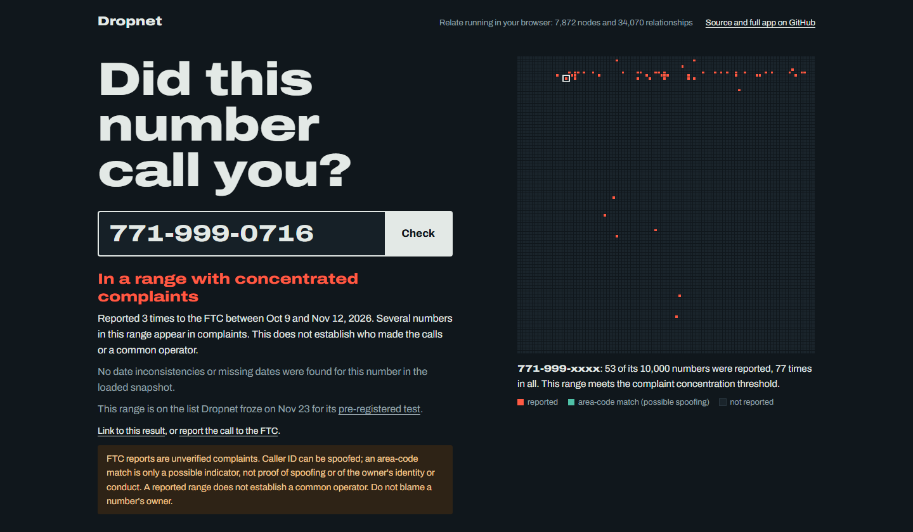

# Dropnet

**Scam reports arrive one at a time. The scams don't.** 92% of the 248,930 phone numbers in 296,273 FTC complaints
were reported exactly once, so a list of reported numbers is always behind. What repeats is the **range**, the first six
digits of a number. Dropnet connects the complaints, numbers, ranges and the carriers that hold those ranges in one
Relate graph, so an analyst can see the pattern and follow the evidence.

**One number.** Rules learned from complaints before Nov 2 matched **4.3%** of the 103,620 later complaints when they
listed repeat numbers, and **14.3%** when they also listed 2,872 flagged ranges. The gain comes from watching ranges,
not from a clever ranking: at the same budget, ranges picked simply by how many numbers were reported from them matched
**14.5%** and ours **14.3%**. What Dropnet adds is the graph: why a range is flagged, who holds it, and what is linked to
it.

**One case.** Dropnet flagged range `365-826` on Oct 19. Over the next 24 days, **323 numbers** from it appeared in
complaints for the first time. No list of numbers could have held them; the range was already flagged.

**Why a graph.** Each US range links to the carrier NANPA lists as its holder. One traversal shows that four of the 15
holders with the most flagged ranges hold 20 or more flagged ranges per 100 they hold, against about 1 for the three
largest wireless carriers, and that unflagged ranges of the leading holders became flagged later 3.7 times as often as
others.

A range or a holder is a lead for a person to check, not proof: complaints are unverified, caller ID can be faked, and
numbers can be ported. Dropnet never blocks anything.

[Open the browser demo](https://ikooq.github.io/dropnet/#early) · [Every result, its method and its limits](docs/EVIDENCE.md)



## Run locally

Python 3.10 or later. No API key, no database server: the graph is the checked-in file `data/ftc.rl`.

```bash
python -m venv .venv
# Windows PowerShell: .venv\Scripts\Activate.ps1
# macOS/Linux: source .venv/bin/activate
python -m pip install -e .
python -m dropnet serve
```

Open [localhost:8000](http://127.0.0.1:8000):

1. Check `771-999-0716`. The result shows **FRACTEL, LLC** as the prefix holder (OCN `965H`, 606 flagged out of
   2,858 prefixes it holds) and **ONVOY, LLC** as the assignee of the 1,000-number block.
2. In **Who holds flagged ranges**, open a carrier to see its flagged ranges, rate centers and complaint categories.
3. Click **Open range 771-999 in graph** in the number result, then choose a range under **Flagged ranges sharing OCN 965H**.
   Run a what-if, or download the case as
   its own `.rl` file.

`python -m dropnet ftc-eval` prints the hold-out table. `python -m dropnet check-claims` checks that the numbers in this README, EVIDENCE, the
submission text and the diagram match it. `python -m pip install -e ".[dev]"` then `python -m pytest`
runs the tests.

## How it uses Relate

- **One file:** `data/ftc.rl` holds 296,273 reports, 248,930 numbers, 96,126 ranges and their NANPA holders, rate
  centers and 1,000-number block assignments, compacted to Parquet with `relate clone`.
- **Cypher on the embedded engine** finds the ranges, ranks holders, and runs what-ifs in a transaction that is rolled
  back.
- **WebAssembly:** the browser demo runs Relate on a smaller graph.
- **MCP:** `.mcp.json` starts Dropnet's own read-only tools (`assess_number`, `carriers`, `read_cypher`, …) and
  `relate serve --mcp` on the same file, so an agent sees the evidence and its caution before it answers.
  It needs the `dropnet` command on PATH: start `claude` from the activated virtual environment. In the Claude desktop
  app, which does not see the venv, add a local entry once:
  `claude mcp add --scope local dropnet -- <repo>/.venv/Scripts/python.exe -m dropnet mcp`
  (`.venv/bin/python` on macOS/Linux).
- Also: full-text and optional vector `SEARCH`, Bolt and the HTTP Query API, and a `relate run dropnet-ftc` extension.
  Details in [EVIDENCE.md](docs/EVIDENCE.md).

Built for the Relate by Neo4j Hackathon. MIT license. FTC, FCC and NANPA public data. AI coding tools assisted the
implementation and documentation; the disclosure is in [EVIDENCE.md](docs/EVIDENCE.md).
