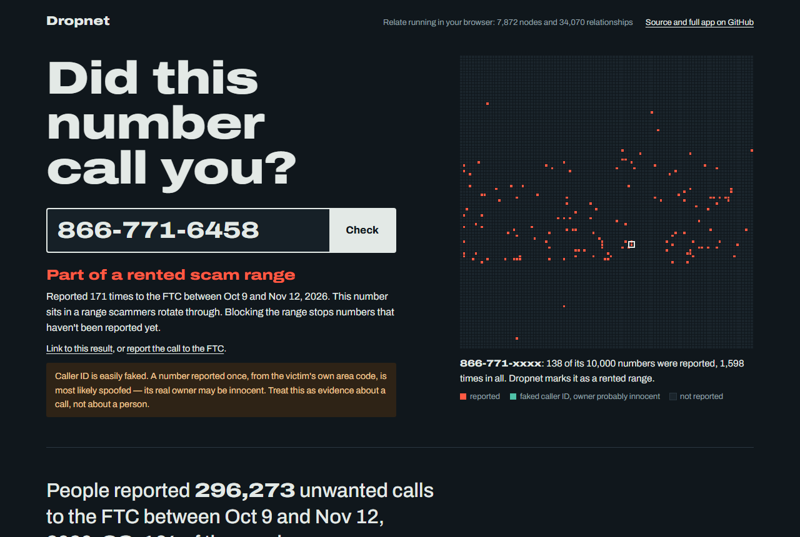
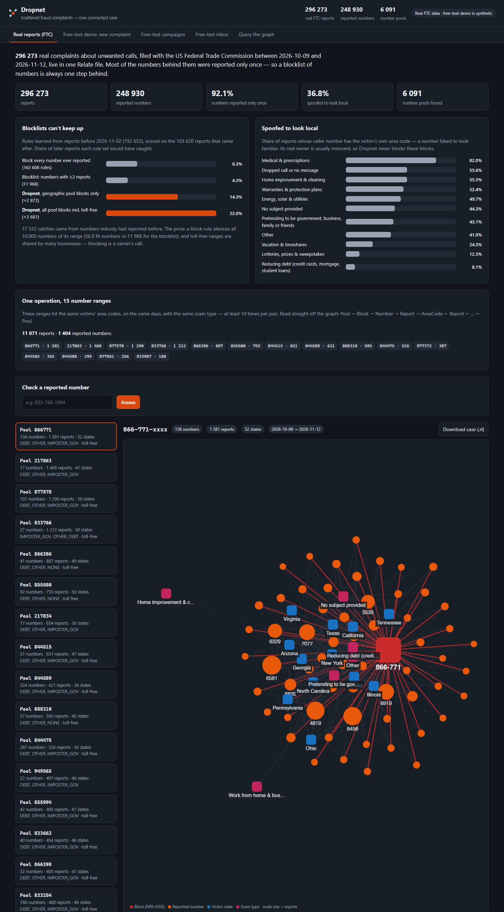
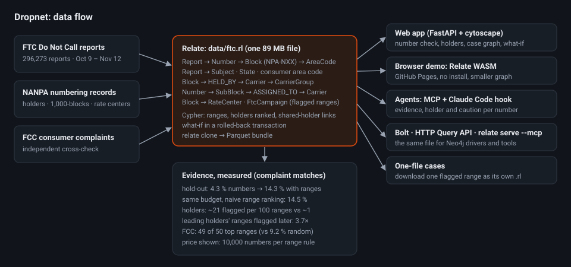

# Dropnet

**Scam reports arrive one at a time. The scams don't.** Dropnet puts 296,273 real phone-scam complaints into an
embedded **Relate** graph and finds the number pools behind them — the rented number ranges a blocklist of single
numbers can never keep up with — while refusing to blame the innocent people whose numbers get spoofed.

**Try it without installing anything: https://ikooq.github.io/dropnet/**
Relate runs in your browser as WebAssembly and loads the 200 biggest real pools in about a second.



<details><summary>More: the full page (pool network, number check, pool graph) and the architecture</summary>





</details>

---

## Use case

Every day ~13,000 Americans report unwanted calls to the FTC. Each report names one caller number. Analysts at
carriers, regulators and anti-fraud teams block numbers — and lose, because:

* **92.1 % of the 248,930 reported numbers were reported exactly once.** Scammers rotate numbers faster than
  blocklists grow.
* **36.8 % of reports come from a number faked to carry the victim's own area code** ("neighbor spoofing"; 82 % for
  medical robocalls). Those numbers belong to innocent people.

The relationship that matters is **Number → Block (NPA-NXX, the first six digits)**. Rented number ranges show up as
*pools*: many different reported numbers in one block, the same scam types, victims in dozens of states. A pool is
visible only in the graph — never in a single report.

| relationship | why it matters |
|---|---|
| `(Report)-[:FROM_NUMBER]->(Number)-[:IN_BLOCK]->(Block)` | one-off numbers that share a rented range |
| `(Report)-[:ABOUT]->(Subject)`, `-[:VICTIM_IN]->(State)`, `-[:VICTIM_AREA]->(AreaCode)` | scam type, reach, and spoofing (caller area = victim area) |
| `(FtcCampaign)-[:USES_BLOCK]->(Block)` | a pool: the unit worth blocking |
| `(Rule)-[:BLOCKS]->(Block or Number)` | what-if rules, written in a transaction and rolled back |

## Results on real data (temporal hold-out)

Rules are learned from reports filed **before 2026-11-02** (192,653) and scored on the **103,620 reports filed after**
— numbers the rules could not have seen.

| rule set | rules | numbers silenced | later reports caught |
|---|---:|---:|---:|
| block every number ever reported | 163,606 | 163,606 | 6.2 % |
| classic blocklist: numbers with ≥ 2 reports | 11,968 | 11,968 | 4.3 % |
| **Dropnet, geographic pools:** those numbers + 2,872 pool blocks | 14,840 | 28.7 M | **14.3 %** |
| Dropnet, all pools incl. 809 toll-free blocks | 15,649 | 36.8 M | 22.0 % |

Pools catch what number lists cannot: **3.3×** the blocklist's coverage from geographic ranges alone (5× with
toll-free ranges), and **17,532** of the catches came from numbers nobody had reported before. The price is explicit in
the table: a block rule silences all 10,000 numbers of an NPA-NXX, and toll-free ranges are shared by many legitimate
businesses — so Dropnet ranks ranges for a carrier's decision, it does not block anything itself. Pools are built from
*non-spoofed* reports only; still, 1,358 caught calls carried a spoofed caller ID inside a pool range, and the what-if
shows that count as a risk. Reproduce: `python -m dropnet ftc-eval`.

**Confirmed by a second agency.** The FCC publishes its own consumer complaints (a different agency, a different
intake form). Over the same weeks it received 13,696 complaints with a caller ID. **49 of Dropnet's 50 largest pools
(98 %)** have FCC complaints from numbers in the same block — against **9.2 %** for random reported blocks (20 draws);
for the top 200 pools, 92.5 % vs 8.7 %. Data: `data/fcc/`, code: `dropnet/ftc/crosscheck.py`.

**Is a pool more than a random block?** A control: the same number of blocks (3,681), drawn at random from the 44,306
blocks that had a non-spoofed report before the split, catches **4.4 %** of later reports; the pool blocks catch
**20.3 %** — a **4.7× lift**. **83 %** of pool rules caught at least one later report (16.7 % stayed dormant).
The FTC page lists ~25 business days; files already downloaded are kept, so running `ftc-build --fetch` weekly grows
the window.

## One operation, fifteen number ranges

Pools are linked when their numbers hit the **same victims' area codes, on the same day, with the same scam type** at
least 10 times (generic subjects left out) — a multi-hop path read straight off the graph:
`(Pool)-[:USES_BLOCK]->(Block)<-[:IN_BLOCK]-(Number)<-[:FROM_NUMBER]-(Report)-[:VICTIM_AREA]->(AreaCode)<-[:VICTIM_AREA]-(Report)-…-(Pool)`.
On the real data this finds **one network of 15 ranges behind 11,071 reports**, including the 217-863 pool; two of its
toll-free ranges (866-386 and 877-578) struck the same area codes on the same day 23 times. Looser settings glue
hundreds of pools into one meaningless blob — the thresholds are chosen to avoid that (`dropnet/ftc/networks.py`).

## The case file is a graph: a markdown vault

`python -m dropnet vault` writes the 50 biggest pools, their blocks, scam types and the pool network as plain markdown
notes in `data/vault/` — one note per node, frontmatter wikilinks per relationship. Relate opens the folder as a graph,
Obsidian opens it as a notebook, and an analyst's edit (a finding, `status: closed`) is in the graph at the next open:

```bash
relate --snapshot-format markdown --markdown-body-properties text --database data/vault   query "MATCH (p:Pool)-[:IN_NETWORK]->(n:Network) RETURN n.name, count(p), sum(p.reports)"
# NET-217863, 14, 10883
```

## Works with the Neo4j ecosystem

The same file speaks **Bolt**, so existing Neo4j drivers and tools work unchanged (tested in `tests/test_bolt.py`):

```bash
relate serve --database data/ftc.rl --read-only --bolt 7687 --auth none     # loopback only
```
```python
from neo4j import GraphDatabase
with GraphDatabase.driver("bolt://127.0.0.1:7687", auth=None) as d:
    print(d.execute_query("MATCH (c:FtcCampaign {kind: 'pool'}) RETURN count(c) AS pools").records)
```

To share confirmed pools with a team's Neo4j / Aura, push only that subgraph (credentials in an env file, preview first):

```bash
relate push --to aura.env --database data/ftc.rl --dry-run   --query "MATCH p = (:FtcCampaign {kind: 'pool'})-[:USES_BLOCK]->(:Block) RETURN p"   --merge-key FtcCampaign:id --merge-key Block:npa_nxx
```

Investigate locally, embedded; publish only what was confirmed.

## How it uses Relate

- **Mode: single file.** `data/ftc.rl` (40 MB, committed) holds the whole graph: 296,273 reports, 248,930 numbers,
  96,126 blocks, 1,531,971 relationships, 6,146 campaigns (6,091 pools, 55 repeat numbers). A second file, `data/dropnet.rl`, holds the free-text module.
- **Why this mode:** the investigation is one portable artifact — judges and colleagues open exactly the graph we built,
  and a single campaign can be handed over as its *own* `.rl` file (`Download case`). Built in a directory store,
  then compacted with `relate clone --to-snapshot-format parquet` (150 MB → 40 MB) so it fits a git repo.
- **What the graph models:** reports, numbers, NPA-NXX blocks, area codes, states, scam types, pool/repeat campaigns —
  plus, in the second module, free-text complaints, cards, IBANs, phishing domains, aliases and money transfers.

| Relate feature | where |
|---|---|
| embedded Python engine (`relate-db`), range indexes, `UNWIND`/`MERGE` batch load (296k reports in ~2 min) | `dropnet/ftc/load.py` |
| campaign detection as Cypher aggregations over the graph | `dropnet/ftc/campaigns.py` |
| **explicit transaction + rollback** for what-if blocking rules | `dropnet/ftc/whatif.py` |
| one campaign → its own single-file store | `whatif.export_case` |
| `relate clone --to-snapshot-format parquet` compaction | `dropnet/ftc/build.py` |
| **WebAssembly build** in the browser demo (in-memory, ~1 s load) | `docs/app.js` |
| vector index + `db.index.vector.queryNodes`, `shortestPath`, variable-length money trails | free-text module |
| **MCP**: our server + Relate's native `relate serve --mcp stdio --read-only` | `.mcp.json` |

## Setup and run

Python **3.10+** (tested on 3.14, Windows 11). No API key, no database server.

```bash
git clone https://github.com/ikooq/dropnet && cd dropnet
python -m venv .venv
# Windows: .venv\Scripts\activate      macOS/Linux: source .venv/bin/activate
pip install -e .
python -m dropnet serve        # → http://127.0.0.1:8000  (opens on "Real reports (FTC)")
```

Then: pick a pool, click a number, run **What-if**, check `833-766-1884`, download a case as `.rl`.

```bash
python -m dropnet ftc-eval                 # the hold-out table above, recomputed from data/ftc.rl
python -m dropnet ftc-build --fetch        # re-download the FTC files and rebuild (needs the Relate CLI to compact)
python -m dropnet site                     # refresh the browser demo data in docs/
python -m dropnet carrier-csv              # data/ftc/ranges.csv: 6,091 ranges, evidence, FCC check, price
pip install -e ".[dev]" && pytest          # 191 tests
```

### Measured: what the graph changes for an agent

On **1,000 random reported numbers** (`python -m dropnet ftc-agent-eval`, seed 0), an agent without the graph that
treats every reported number as a scammer would **blame 395 (39.5 %) likely-spoofed numbers** — reported once, from the
victim's own area code, owners probably innocent — and would **dismiss 246 (24.6 %) once-reported numbers that belong to
an active pool**. With Dropnet the agent receives the right verdict for every one of them (via the hook or the
`assess_number` MCP tool), together with the spoofing caution.

### With an AI agent

Start Claude Code **from the activated venv** in this folder:

* **MCP** (`.mcp.json`): `assess_number`, `ftc_campaigns`, `whatif_block`, `ftc_summary` (+ the free-text tools) via
  `dropnet mcp`; Relate's own MCP server on the snapshot via `relate-native`.
* **Hook** (`.claude/settings.json`, `UserPromptSubmit`): whenever a prompt mentions a phone number, the agent receives
  the graph's evidence about it *and* the spoofing caution before it answers (0.75 s). Ask *"Should we block
  833-766-1884?"* — the agent learns it sits in a 27-number pool reported 1,202 times in 50 states, and is told not to
  call the owner of a one-off local number a scammer.

## Where the data lives

| path | what |
|---|---|
| `data/ftc.rl` | **the Relate store** — real FTC reports (single file, committed) |
| `data/ftc/raw/*.csv.gz` | the 25 daily FTC files as downloaded (US public data) |
| `data/ftc/eval.json` | the hold-out result |
| `docs/data/graph.json` | the slice the browser demo loads into Relate WASM |
| `data/dropnet.rl`, `data/raw/` | second module: free-text complaints (synthetic, Russian) |
| `data/live/` | working copies the app writes to (git-ignored) |

## Also included: a free-text demo module (synthetic data)

Some victims write a story instead of naming a number. A smaller demo module (tabs *Free-text …*, data in
`data/dropnet.rl`, **synthetic** Russian complaints) shows the same idea on free text: phones, cards, IBANs, phishing
domains, aliases and bank transfers extracted with character spans, complaints linked through **money trails up to
three transfers deep** and by script similarity (Relate vector index), and case files that quote the victim for every
link. It is a demonstration of the extraction pipeline, not part of the real-data results above.

## What we learned about Relate 1.0.1 (shared for the team)

* A multi-hop pattern started from an `UNWIND`-bound key —
  `UNWIND $ns AS x MATCH (:Number {number: x})<-[:FROM_NUMBER]-(r:Report)-[:VICTIM_IN]->(s:State)` — took 21 s for 60
  keys on the 249k-number graph, while the same data reached from an indexed anchor (`(:FtcCampaign {id})`) took
  0.03 s. A plain `UNWIND … MATCH (:Number {number: x})` was fast (0.33 s for 5,000), so the planner's choice of start
  point is the likely cause.
* In the WASM build a per-row property `MATCH` costs ~0.5 ms and `MERGE` inside `FOREACH` ~0.7 ms; collecting nodes
  into lists once and addressing them as `xs[i]` loaded 34k relationships in ~1 s instead of 13–19 s.
* `relate.Record` serialises only its result columns, so keys added in Python vanish from JSON — copy to `dict`.
* A writable open of a `.rl` file checkpoints (rewrites) it; open snapshots with `--read-only` / `read_only=True`.

## Limits and honest notes

* FTC numbers are numbers people *reported*, not proven offenders; caller ID is easily spoofed. The UI, the MCP tools
  and the hook all carry that caution, and spoofed local ranges are never proposed for blocking.
* A pool block covers up to 10,000 numbers; blocking one is a carrier decision with collateral risk. The what-if shows
  the reports a rule would have stopped, not the legitimate calls it might block.
* The hold-out spans 35 days of reports; longer windows may shift the numbers.

License: MIT. Built for the Relate by Neo4j hackathon (2026). FTC Do Not Call complaint data is US public data.
