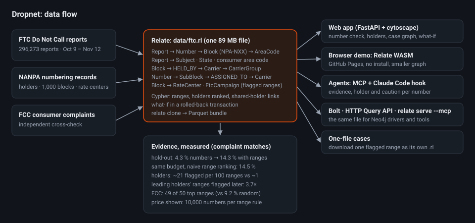
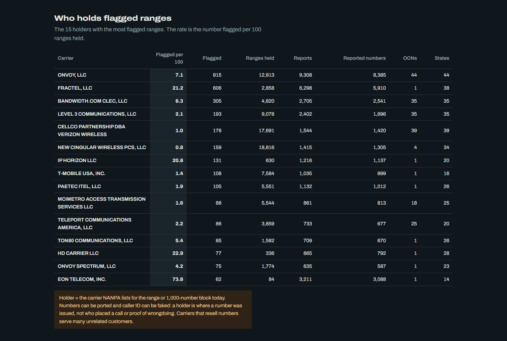
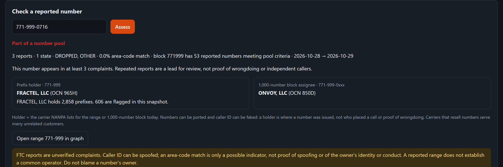
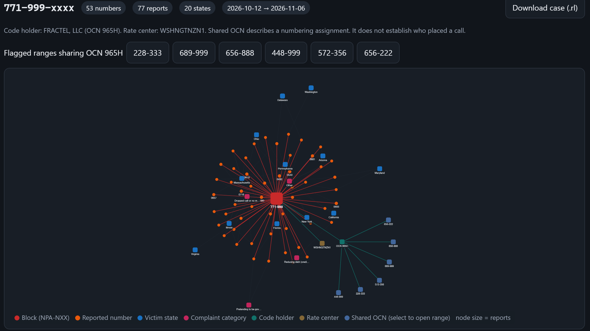

# Evidence index

Every number in the README and the submission, where it is stored, and how to reproduce it. Run the commands from the
repository root after `pip install -e .`.

| Claim | Result file | Reproduce |
|---|---|---|
| Hold-out: 4.3% → 14.3% (22.0% with toll-free) of 103,620 later complaints | `data/ftc/eval.json` (`baseline`, `dropnet_geographic`, `dropnet`) | `python -m dropnet ftc-eval` |
| Equal budget of 2,872 geographic prefixes: Dropnet 14.31%, naive 14.52% | `data/ftc/eval.json` (`dropnet_geographic`, `naive_geographic`) | `python -m dropnet ftc-eval --split 2026-11-02` |
| Same, on call dates after the split: 3.5% → 12.7% | `data/ftc/time_audit.json` | `python -m dropnet.ftc.time_audit` |
| Fresh data after the snapshot: 3.6% → 13.2% (3.3% → 11.8% by call date) | `docs/evaluation/fresh-ftc-2026-11-18.json`, [report](evaluation/fresh-ftc-2026-11-18.md) | `python scripts/evaluate_fresh_ftc.py --train-dir data/ftc/raw --test-dir data/ftc/fresh-2026-11-18` |
| Early warning: 2.6% vs 11.9% replayed day by day; 4,713 ranges, median 14 days; 23,726 numbers seen first in a flagged range | `data/ftc/eval.json` (`early_warning`) | `python -m dropnet ftc-early-warning` |
| Pre-registered forward test: lists frozen 2026-11-23, checked on files published after 2026-11-19 | `docs/prediction/` (`manifest.json`, hashes) | `python scripts/preregister.py check --prediction docs/prediction --test-dir data/ftc/after-freeze` |
| 27 of 27 start days, lift ≥ 2.6×; bootstrap intervals; threshold sweep; ablations | `data/ftc/eval.json` (`robustness`) | `python -m dropnet ftc-robustness` |
| Random-range control: 20.3% vs 4.4% | `data/ftc/eval.json` (`controls`) | `evaluate.controls(conn, "2026-11-02")` in `dropnet/ftc/evaluate.py` |
| FCC cross-check: 49 of 50 largest ranges vs 9% random | `data/ftc/eval.json` (`fcc_crosscheck`), `data/fcc/` | `crosscheck.crosscheck(...)` in `dropnet/ftc/crosscheck.py` |
| Hybrid search: 0.78 vs 0.29 precision at 10 on 14 descriptions | `data/ftc/search_eval.json` | `dropnet/ftc/semantic.py` (`evaluate`), needs `pip install -e .[semantic]` |
| Range holders: flagged ranges per 100 ranges held, e.g. 21.2 for one carrier vs 1.0 for Verizon Wireless | `data/ftc/eval.json` (`carriers`) | `python -m dropnet ftc-numbering --eval-only` |
| Holder as an early signal: unflagged ranges of the 10 leading holders flagged later 7.5% vs 2.1% (3.7×; 3.2×–4.1× over 4 start days) | `data/ftc/eval.json` (`carrier_prior`, `carrier_prior_splits`) | `python -m dropnet ftc-numbering --eval-only` |
| Real agent, 40 numbers, with and without the MCP tool | `data/ftc/live_agent_eval.json` | `python -m dropnet ftc-live-agent-eval` (calls the `claude` CLI) |
| Blinded review of 30 ranges by one reviewer | [validation-study/EXPERT_REVIEW.md](validation-study/EXPERT_REVIEW.md) | protocol in [validation-study/PROTOCOL.md](validation-study/PROTOCOL.md) |
| Relate extension: 296,273 reports → 6,091 ranges in 33 s | — | `python -m dropnet relate-ext`, then `relate run dropnet-ftc --path data/ftc/raw -d graph` |

Not evidence, kept as a record: the two review rounds in [independent-review/](independent-review/README.md) (see the
note at the top of each report).

All results are matches against unverified FTC complaints. They are not calls blocked, fraud proven or a measure of
harm to legitimate callers; the data contain no legitimate calls.

## Equal-budget comparison

Both range methods start with the same repeat-number rules and add exactly 2,872 geographic NPA-NXX prefixes. The naive method ranks prefixes by the number of distinct caller IDs in training, retaining area-code matches. It breaks ties by prefix. Dropnet selects prefixes with at least five distinct caller IDs after excluding area-code matches. Both methods use only pre-split complaints to select rules.

| Method | Matches | Share of later filings | Possible numbers covered | Matches per million possible numbers |
|---|---:|---:|---:|---:|
| Repeat numbers only | 4,496 | 4.34% | 11,968 | 375,668.4 |
| Repeat numbers + Dropnet geographic prefixes | 14,825 | 14.31% | 28,730,391 | 516.0 |
| Repeat numbers + naive geographic prefixes | 15,043 | 14.52% | 28,730,239 | 523.6 |

The prefix budgets are equal. The exact address-space capacities differ by 152 numbers because a repeat number already inside a selected prefix is counted once. The denominator is possible numbers covered by rules. Multiple complaints about one number can each count as a match. These figures measure complaint coverage, with no estimate of legitimate-call traffic or of verified fraud. The naive rule matched slightly more complaints on this hold-out, so Dropnet's ranking is not better at finding complaints: the gain over repeat numbers comes from watching prefixes at all. The comparison supports investigating prefixes and leaves the value of the area-code filter for analyst triage open. What Dropnet adds beyond the ranking is the graph around each prefix: the complaints that flagged it, its NANPA holder and 1,000-block assignee, and the other flagged prefixes that share that holder.

## Who holds flagged ranges

The graph joins each US range to the carrier NANPA lists as its holder (`Block → HELD_BY → Carrier → PART_OF → CarrierGroup`,
NANPA files dated 2026-11-27). Counting flagged ranges per holder is one Cypher traversal; dividing by the ranges each
holder has across the whole numbering plan shows which holders are over-represented:

| Holder | Ranges held (all of NANP) | Flagged ranges | Flagged per 100 held |
|---|---:|---:|---:|
| FRACTEL, LLC | 2,858 | 606 | 21.2 |
| IP HORIZON LLC | 630 | 131 | 20.8 |
| ONVOY, LLC | 12,913 | 915 | 7.1 |
| BANDWIDTH.COM CLEC, LLC | 4,820 | 305 | 6.3 |
| T-MOBILE USA, INC. | 7,584 | 108 | 1.4 |
| CELLCO PARTNERSHIP DBA VERIZON WIRELESS | 17,691 | 178 | 1.0 |
| NEW CINGULAR WIRELESS PCS, LLC | 18,816 | 159 | 0.8 |

The large carriers hold many flagged ranges because they hold many ranges. A few smaller holders hold far
more flagged ranges than their size predicts.

**Holder as an early signal.** From complaints before 2026-11-02 only, each holder gets a rate: flagged ranges per
range held (holders with at least 100 ranges). The 10 highest are the leaders. Then, among the 61,384 geographic
ranges that had a complaint before the split but were not flagged, 9,002 belong to a leader. Once later
complaints are added, 7.5% of those become flagged against 2.1% of the other
52,382 (3.7×). 686 of the 1,841 newly flagged ranges belong to a leader.
The same test from other start days and with 25 leaders:

| First test day | Leaders | Leaders' open ranges flagged later | Others | Lift |
|---|---:|---:|---:|---:|
| 2026-10-20 | 10 | 22.3% | 7.0% | 3.2× |
| 2026-10-20 | 25 | 19.5% | 6.2% | 3.2× |
| 2026-10-26 | 10 | 13.7% | 4.0% | 3.4× |
| 2026-10-26 | 25 | 12.0% | 3.5% | 3.5× |
| 2026-11-02 | 10 | 7.5% | 2.1% | 3.7× |
| 2026-11-02 | 25 | 6.6% | 1.7% | 3.8× |
| 2026-11-06 | 10 | 4.3% | 1.1% | 3.8× |
| 2026-11-06 | 25 | 3.9% | 0.9% | 4.1× |

Limits: the holders come from today's NANPA files, not from the complaint dates (assignments do not depend on
complaints, but some can have changed). A holder issued a number; numbers can be ported, and caller ID can be faked, so
a holder is not the caller and this is no finding of wrongdoing. Some holders provide numbers to many unrelated
customers. Toll-free and Canadian ranges have no holder in these files. NANPA lists one name with a typo variant
(`ONVOY, LLCV`) that is counted as a separate holder.

## Numbering data and queries

The full database, `data/ftc.rl`, contains the FTC snapshot and the matching US central office codes and thousands-block records from the [NANPA reports](https://www.nanpa.com/reports/thousands-block-reports/region). The three files in `data/nanpa/` contain the extracted inputs for this graph. Run `python -m dropnet ftc-numbering` with the Relate CLI installed to apply the checked-in inputs. Adding `--fetch` downloads the current files and can change assignments. The FTC timeline for `365-826` refers to a Canadian range, outside the US assignment extract.

- `Block → HELD_BY → Carrier` gives the six-digit code holder by OCN. `Block → IN_RATE_CENTER → RateCenter` gives the rate center.
- `Number → IN_SUBBLOCK → SubBlock → ASSIGNED_TO → Carrier` gives the assignee of a thousand-number block where the source provides one. A block can be assigned to a different carrier than the code holder.

- The local UI can rank OCNs by distinct flagged ranges and traverse from one range through its holder to related ranges. Shared assignment describes numbering administration. Portability and caller-ID spoofing limit attribution, and a rate center describes the numbering resource rather than the caller's location.

## Reproducibility and disclosure

- `python -m dropnet ftc-build` rebuilds from the local FTC files. `--fetch` adds current reports. `python -m dropnet site` regenerates the browser data. `python -m pip install -e ".[dev]"` and `python -m pytest` run the tests.
- The local app uses a full embedded Relate store and supports transactions and `.rl` case export. The public WebAssembly demo uses a smaller derived graph and a browser lookup. Bolt and HTTP Query API v2 examples are in [bolt.py](../dropnet/ftc/bolt.py). The `dropnet-ftc` Relate command extension is in [relate_ext](../dropnet/relate_ext/).
- Optional semantic search uses local embeddings and a graph filter. The benchmark requires `pip install -e ".[semantic]"`. The FTC workflow and configured read-only Relate MCP server require no model or API key.
- FTC and FCC supply public complaint data. NANPA supplies numbering assignments. `data/dropnet.rl` is the archived synthetic research dataset and is separate from every FTC result and the supported FTC interface.
- AI coding tools assisted implementation, tests, evaluation and writing. The project is MIT-licensed. The [submission disclosure](devpost.md#ai-assisted-development) says which parts were mine and which were AI-assisted. The app server is intended for a trusted local machine.
